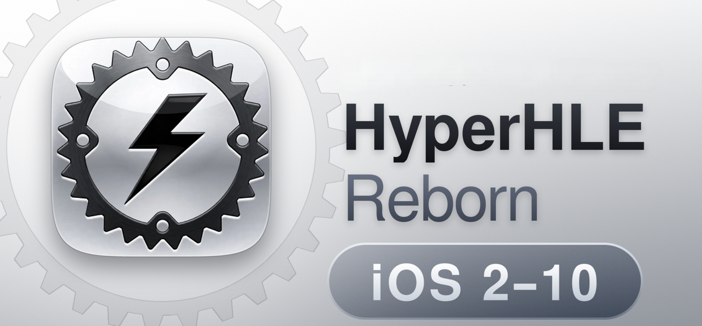

# HyperHLE-Reborn

<p align="center"></p>
HyperHLE-Reborn is a community-maintained fork of [HyperHLE](https://github.com/HyperHLE/HyperHLE), itself based on [touchHLE](https://github.com/touchHLE/touchHLE). The user-facing name of this project is
HyperHLE

HyperHLE is a high-level emulator for early iPhone OS apps. It reimplements selected iOS frameworks on the host, allowing compatible apps to run without booting iOS. This fork focuses on Android/mobile usability, fullscreen and orientation handling, graphics compatibility, and app-specific fixes. It is not an official Apple product.

The repository does not distribute commercial apps or iOS firmware. Put an app bundle (`.app`) or IPA (`.ipa`) that you are entitled to use in `HyperHLE_apps/`; it will appear in the app picker.

## Platforms and features

- Builds for Android, iOS, Windows, macOS, and Linux. The iOS app comes from [Applesauce](https://github.com/johnny901901901/Applesauce); see [`platform/ios`](platform/ios/README.md).
- Virtual iPhone and iPad device profiles.
- Android touch input and fullscreen/orientation handling.
- SharpEmu-style performance display: full counters with a 128-frame graph, minimal panel, or title-bar summary. **F1** toggles it; **F2** cycles panel corners. Mobile builds expose Full/Minimal modes in the app picker; `titlebar` falls back to Minimal where the OS has no title bar.
- The GLES backend reports `Q DIRECT` and tracked `GLALLOC` storage instead of inventing Vulkan queue/allocation counts. Android GPU load uses readable vendor counters; kernels that hide them can still show `GPU N/A`. `GC 0/0/0` is expected because HyperHLE is written in Rust and has no garbage collector.
- Ongoing GLES, EAGL, Core Animation, audio, and iOS framework compatibility work.
- Download build artifacts from the [HyperHLE GitHub Actions workflow](https://github.com/KlugKlugTG/HyperHLE-Reborn/actions/workflows/HyperHLE_release.yml).

## Changelog: what this fork adds

Everything below exists only in HyperHLE-Reborn-Experimental, not upstream [HyperHLE-Reborn](https://github.com/KlugKlugTG/HyperHLE-Reborn): about 21,000 lines across 98 files. It is grouped by area, and the git history has the per-commit detail. Release notes and credits live in [`CHANGELOG.md`](CHANGELOG.md), and the command-line equivalent of every setting is in [`OPTIONS_HELP.txt`](OPTIONS_HELP.txt). Much of the iOS framework work is ported from [MarkusMaribu/VetusCore](https://github.com/MarkusMaribu/VetusCore).

### Settings screen

Each of these settings used to be a command-line flag or an entry in a hand-edited text file. They are now a native iOS-style screen in the app picker, with a scrollbar, a one-tap reset, and a plain-language description under each row, grouped into DISPLAY, GRAPHICS, INPUT, CORRUPTION, DEVICE, EMULATION and RESET.

- **Renderer Mode** replaces the old "Native GLES" toggle (Android only). ANGLE translates the game's graphics calls; Native GLES uses your device driver. One choice instead of two switches that could contradict each other.
- **GLES2 compatibility** (Off, Prefer context, GL2.1) controls how an app's ES 1.1 request is upgraded, and can select the older GL2.1 compatibility backend. Both used to be environment variables.
- **Presentation mode** (Auto, Direct, Readback) and **Force Composition** expose the display path. This is often the difference between a picture and a black screen on drivers that mishandle one route.
- **Diagnostics** moved into the screen as toggles: Trace GL errors, Trace GL draws, Error popups and the performance display. The performance display is now off by default and no longer reappears after being switched off.
- **CORRUPTION** is its own section for the opt-in RTCV-style (Real-Time Corruptor) memory corruption engine: startup delay, cooldown, bytes per burst, maximum allocation offset and a seed, so an interesting run can be repeated exactly.
- **DEVICE** picks the emulated iPhone, iPad or iPod model (each entry now shows its resolution) and the language order the app sees. **EMULATION** covers network access and a local Game Center sign-in.
- **Scrolling works.** Vertical scrolling was restored, the list no longer drifts sideways when a finger moves horizontally (the content was 10 points wider than the scroll view, and scroll views had no direction lock), and manual text-entry fields no longer lose their text.

### Rendering

- **Native ES 1.1 rendering.** The backend no longer silently drops features, so scenes that used to lose depth, blending or texture state now draw as the app intended.
- **Texture workarounds are shared.** The non-power-of-two and level-0 upload fixes now cover every upload path and the ES 1.1 translators, the texture min-filter is applied after upload, host vertex arrays are used where available, and `GL_EXTENSIONS` is queried once per context instead of once per extension.
- **Presentation is observable.** EAGL logs which route presented a frame (direct, readback or software composition), drains start-up GL errors, and reports drawable capabilities. A framebuffer with no depth buffer now behaves as if depth testing were disabled, which is what ES specifies, and alpha is reported correctly for non-opaque layers.
- **GL error attribution.** An error is reported against the call that raised it rather than whichever call happens to ask next.
- **Per-frame draw statistics.** "The screen is black" and "the screen is see-through" are now answered with recorded state instead of guesses.
- **Texture crop rectangles** (`GL_TEXTURE_CROP_RECT_OES`, which the `DrawTex*OES` calls read) are accepted without an environment flag, and PVRTC allocations validate their dimensions instead of trusting the caller.
- **Attribute and error plumbing.** `glVertexAttrib*fv` reads every component it was asked for instead of just the first, and driver errors survive the emulator's own validation calls.
- **ANGLE fails gracefully.** Desktop-GL backends are skipped when ANGLE can translate, context creation reports every backend it tried instead of panicking, a compatibility profile is retried, and a missing context leaves EAGL returning nil.

### UIKit and Core Animation

- **Core Data persistence.** A real store with model parsing, relationships (to-one and to-many, inverse links, delete rules) and atomic saves. Apps that keep save games, settings or caches in Core Data now actually keep them; the old code was a stub.
- **UITableView.** Taps reach the delegate (`willSelect` can veto, `didSelect` fires), with grouped section headers, the standard plain, Value1, Value2 and Subtitle cell styles, a cell reuse pool, accessory chevrons and checkmarks, multi-select, and scroll-to-row. Menu screens and settings lists respond to taps instead of ignoring them.
- **UITextField.** Placeholders, border styles, per-state background images, accessory views and the full set of editing events, so text entry screens render and report editing.
- **UINavigationBar, UINavigationController and UIActionSheet.** Bars compute their title, prompt and back button on demand, controllers push and pop and lay their children out, and action sheets draw their buttons and report dismissals. Previously the bar drew nothing and a sheet called its cancel callback immediately.
- **Transitions.** `CATransition` fades, `+transitionWithView:` and modal cross-dissolves, and page-curl transitions drawn as page turns. `CALayer` masks and `masksToBounds` composite through offscreen targets, so round avatars, faded edges, vignettes and spotlight effects render instead of drawing as hard rectangles.
- **`CATransform3D` animation** decomposes rotation and scale and slerps the rotation, so a rotating layer keeps its size. When one end is singular (a layer growing from zero scale) it borrows the other end's rotation instead of halving the turn.
- **Autorotation.** The root view rotates once after launch, bracketed by `willRotateToInterfaceOrientation:`, `willAnimateRotationToInterfaceOrientation:` and `didRotateFromInterfaceOrientation:`, so landscape games stop presenting a renderbuffer built for the wrong orientation. A game that rotates mid-session also presents the right way up.
- **Push-mode Core Motion.** Accelerometer samples reach the queue and block handler instead of being dropped; the gyroscope reports that it is unsupported.
- **NSPredicate.** Format strings parse and the common comparisons evaluate, and CG bitmap contexts honour blend modes.
- **UIWebView.** Pages render through the platform web view bridge on Android instead of showing an empty box.

### App support

- **Gun Bros 2** is supported, which took a set of interface fixes that the same pass turned up.
- **Movie playback** letterboxes or crops video according to the player's scaling mode instead of stretching it to the screen, and keeps its background view in step with the player's frame.

### CPU and runtime

- **Interpreter fallback.** Instructions the ARM backend cannot decode now run in the interpreter, with per-site counters, instead of stopping the app. Missing NEON instructions are emulated in software.
- **Loader and ABI fixes.** Unresolved symbols and instruction encodings the backend rejects are handled instead of aborting the app.

### Build, CI and docs

- **Release workflow** hardened for macOS and Linux, with the macOS Intel build opt-in, a working test matrix, a cache cleanup workflow, parallel CMake builds and ANGLE caching.
- **Documentation** kept in step: `OPTIONS_HELP.txt` lists every flag, `CHANGELOG.md` carries the release notes, and `HANDOFF.md` records in-flight investigations.

## Newly tested and working games

The titles below have been tested with HyperHLE-Reborn and are known to run. Compatibility may still vary with the app version, virtual device profile, host GPU/driver, and settings; this list does not guarantee that every feature or a full playthrough works. Also any update can break these games in list, report if it doesn't work

- N.O.V.A. 3 (Playable)
- Gangstar Vegas (Ingame)
- Geometry Dash (Playable)
- Modern Combat 3 (Playable)
- Asphalt 7 (Playable)
- Turbo Dismount (Playable)
- Scarface (Playable)
- Zombie Safari (Playable)
- Real Racing 1 (Playable)
- Real Racing 3 (Playable)
- Silent Ops (Playable)
- Need For Speed: Most Wanted (Playable)
- Minecraft 0.16.2 (Playable)
- Oceanhorn (Playable)
- Asphalt 8 1.0.0-1.7.2 (Playable)
- GTA 3 (Ingame)
- Granny (Ingame)
- BioShock (Ingame, not tested)
- Talking Tom Hero Dash (Playable)
- My Talking Hank (Playable)
- Subway Surfers 1.118.0 (Playable)
- Minion Rush 6.3.0 (Playable)
- And more more games

## Build and documentation

Build and run a desktop version with Cargo:

```sh
cargo run --release -- path/to/app.app
```

For iOS build steps and the unsigned IPAs, see [`platform/ios`](platform/ios/README.md). For Android build steps, see the `android/` directory and the [CI workflow](https://github.com/KlugKlugTG/HyperHLE-Reborn/actions/workflows/HyperHLE_release.yml). Command-line options are documented in [`OPTIONS_HELP.txt`](OPTIONS_HELP.txt); notable compatibility changes are tracked in [`CHANGELOG.md`](CHANGELOG.md).

## Community

Join the [HyperHLE Discord server](https://discord.gg/ZpEkAV47H9) to discuss the project and contribute.

## Credits and license

Thanks to everyone who got BioShock this far in HyperHLE:

- **Tog991 (goodvids56)**, developer of [HyperHLE](https://github.com/HyperHLE/HyperHLE), fixed the game's launch itself.
- **uxazu**, creator of Aemulator, fixed the game up to the menu and half-implemented the video player.
- The [Podroid](https://github.com/shawnw67/Podroid) fork got it through its level loads and in-game.

HyperHLE-Reborn carries forward work from HyperHLE and touchHLE contributors and uses open-source libraries. It is licensed under the [Mozilla Public License 2.0](LICENSE); see the individual projects for their respective notices and licenses.
